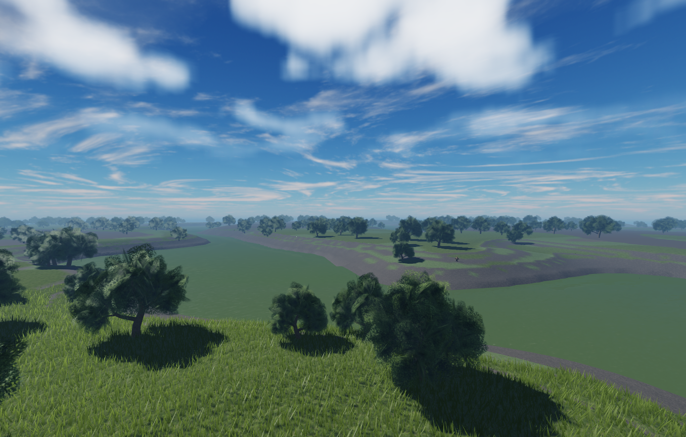
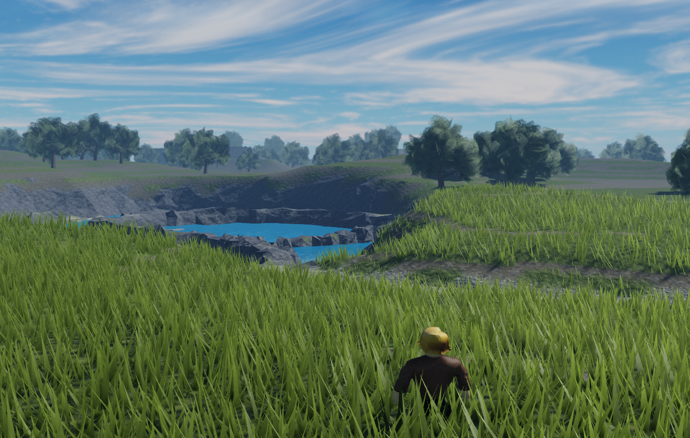
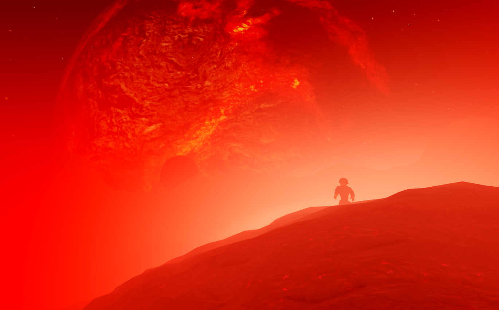
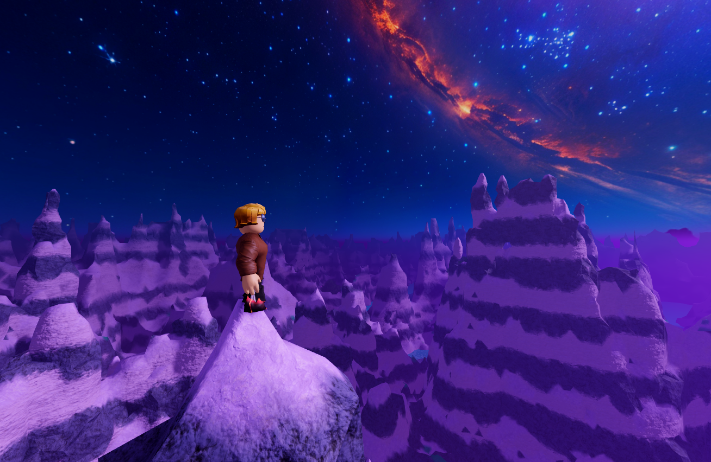
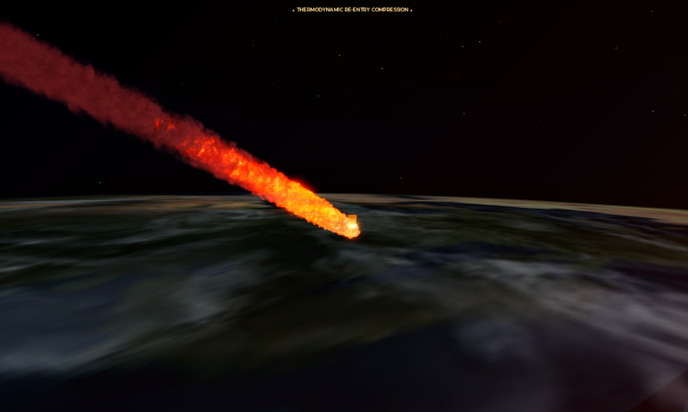

# Utilities Hub

## About

This repository serves as a hub for organizing and maintaining all carinae scripts.

## Contents

The repository may include:

- **Scripts & Tools** — Utilities for client modding games.
- **Development Utilities** — Tools and helpers for development and testing.
- **Experiments** — Small projects, prototypes, and experimental features.
- **Miscellaneous** — Other useful utilities that don't fit into a specific category.

## Usage

Browse the repository to find the utility you need. Individual tools may have their own instructions, requirements, and usage examples.

Make sure to check the relevant files or documentation before running a utility.

## Project Status

This repository is continuously maintained and may evolve as new utilities are added, existing tools are improved, and older projects are updated.

## License

Unless otherwise specified, refer to the license or usage terms provided with each individual project.

# Hub addendum

terraform -> loadstring(game:HttpGet("[https://raw.githubusercontent.com/Gnelfling/Carinae_hub/refs/heads/main/terraform.lua](https://raw.githubusercontent.com/Gnelfling/Carinae_hub/refs/heads/main/terraform.lua)"))()

# Gallery

## Terraform ---------------

----------------------------
